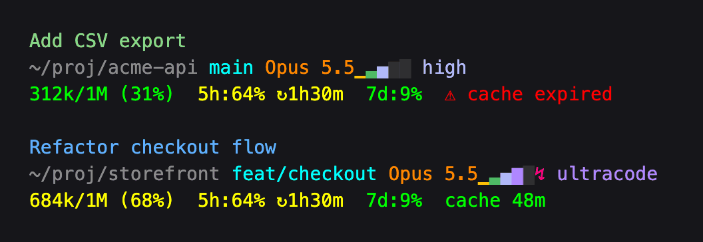

# claude-code-statusline

A lightweight multi-line status line for [Claude Code](https://www.claude.com/product/claude-code): session name, git branch, model, effort level, context window, 5h / 7d rate limits, and a prompt-cache countdown. One Bash script, nothing to install.



## Why another status line?

Most Claude Code status lines are small apps: a Node package run through `npx`, a compiled binary, a Python daemon, or a shell framework with themes and a config file. That's great if you want a dashboard. This project goes the other way: show the few things you actually glance at, and cost your machine next to nothing.

- **One file.** `statusline.sh` is ~170 lines of Bash and awk plus comments. Read it in ten minutes, change it in place.
- **Fast.** ~8 ms per render on an Apple M4 Pro with the stock macOS bash, under 3 MB peak memory — and ~1.5 ms of that is bash itself starting. A single `awk` pass parses the whole session JSON, and the git branch is read straight from `.git/HEAD`, with no `git` process.
- **Nothing in the background.** No daemon, no cache files, no config file, no network calls. It runs only when Claude Code asks for a redraw: after each message, and once a minute (`refreshInterval`) so the countdowns keep moving while you're idle. The plugin install adds one short script that runs once at session start (about 45 ms, plus a 2-second background wait in the session that writes the block) and nothing per render.
- **Uses what Claude Code already sends.** Session name, effort level, context window, rate limits and prompt cache all come from the JSON on stdin — no API calls, no transcript parsing (the one exception: at `xhigh` effort, a fast grep of the transcript to tell ultracode apart).
- **Nothing to install.** Needs only bash, awk and grep, which every macOS and Linux system already has — no `jq`, no Homebrew. Tested with bash 3.2 through 5.3 and the macOS, GNU, mawk and BusyBox awks.

## Install

No dependencies: works out of the box on macOS and Linux.

### As a plugin

Inside Claude Code, pick user scope when asked:

```
/plugin install bash-statusline --marketplace TurboKach/claude-code-statusline
```

Or from the shell:

```bash
claude plugin marketplace add TurboKach/claude-code-statusline
claude plugin install bash-statusline@cc-statusline --scope user
```

Then start a new session. The bar appears there, not in the one you installed from.

At session start, a small hook points a link in the plugin's data folder at the current version of `statusline.sh`. When the file has no `statusLine`, it also adds the block to `~/.claude/settings.json` (or `$CLAUDE_CONFIG_DIR/settings.json`), with a timestamped `settings.json.bak.*` backup. It waits about 2 seconds first, so Claude Code's own settings watcher sees the change, and that wait runs in the background. While the plugin is enabled it adds the block back in any session where none is set. To stop using the bar, uninstall or disable the plugin, then remove the block.

If you already have a `statusLine`, the plugin leaves it alone and shows a one-time message on how to switch. To replace it, turn on the option "Replace an existing status line": in `/plugin` go to Installed → bash-statusline → Configure options, or run `claude plugin configure bash-statusline@cc-statusline`. The plugin replaces an existing status line only if one was there before the plugin first wrote its own; a different bar you set later is left alone. Then start a new session. The shell install does not ask, so to replace an existing bar there, add `--config replace_existing=true` to the `claude plugin install` command.

### From a clone

Use this to read and edit the script.

```bash
git clone https://github.com/TurboKach/claude-code-statusline.git
cd claude-code-statusline
./install.sh
```

The installer **symlinks** `~/.claude/statusline-command.sh` to the cloned `statusline.sh` and points the `statusLine` setting in `~/.claude/settings.json` at it, with a 60-second `refreshInterval` (other settings preserved, a timestamped backup saved alongside). No restart needed — the bar updates on its next render.

Keep the clone around, since the install is a symlink to it. If you installed before the cache countdown existed, run `./install.sh` once more so it ticks while you're idle.

## Update

**Plugin.** Auto-update is off for this marketplace by default. To turn it on, go to `/plugin` → Marketplaces → cc-statusline → Enable auto-update. To update by hand:

```bash
claude plugin marketplace update cc-statusline
claude plugin update bash-statusline@cc-statusline
```

Then restart Claude Code. Run the marketplace update first: `plugin update` alone does not see a new version until the marketplace is refreshed.

Maintainers: a release is a `version` bump in `.claude-plugin/plugin.json`. Without one, no update ships.

**Clone.** Run `git pull`.

## What it shows

- **Line 1 — session name.** Your `/rename` name, or Claude's auto-generated session title, colored per project (each launch directory gets a stable hue, so parallel sessions are easy to tell apart). Hidden until the session has a name.
- **Line 2 — where and how.** Working directory, git branch (or short SHA when detached), model name, and an **effort bar**: one cell per reasoning level the model supports (`low · medium · high · xhigh · max` on Opus 5.5), lit up to the active level in Claude Code's own `/effort` colors, followed by the level name. When **ultracode** is active (xhigh effort driving a multi-agent workflow), the bar fills to the `xhigh` cell, a magenta **`↯`** appears after it, and the label reads `ultracode`. The bar hides on models without effort levels.
- **Line 3 — budget.** Context-window usage (`used / max (pct%)`) and the 5-hour / 7-day rate-limit meters, green → yellow at 50% → red at 75%. From 90% the context reads **`⚠`** first: time to `/compact` at a point you choose. From 50% a meter adds `↻` and the time until that window resets. Rate limits appear for Claude.ai Pro / Max subscribers after the first response. Last comes the **prompt cache**: `cache 42m` is the time until Claude's cached copy of the conversation expires (1 hour on a Claude subscription, 5 minutes with an API key or once you're on usage credits), colored the same way by how much of that time has passed. Each message restarts it. Once it runs out it reads **`⚠ cache expired`** in red: your next message re-sends the whole conversation, so it's slower and costs more. Appears after the first response.

## Customize

Everything lives in `statusline.sh`. Edit it in a clone (see "From a clone"): a plugin update replaces the plugin's cached copy, so changes there are lost.

- **Project colors** — `proj_hues=(...)`, the 8 ANSI-256 colors assigned per project.
- **Other colors** — the `--- Colors ---` block near the top.

Because the clone install is a symlink, edits show up on the next render.

## Uninstall

**Plugin.** Run `/plugin uninstall bash-statusline@cc-statusline`, then remove the `statusLine` block from `~/.claude/settings.json` (a timestamped backup sits next to it). Do both: the block points at the plugin's data folder, which uninstall deletes, so the bar breaks if it stays. Disabling the plugin does not remove the bar: the block and the link stay.

**Clone.** Remove the `statusLine` block from `~/.claude/settings.json` (a timestamped backup sits next to it), then optionally `rm ~/.claude/statusline-command.sh`.

## License

[MIT](LICENSE)
